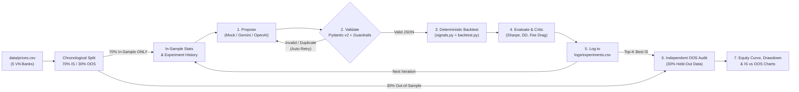

# Agentic Quant Research & Backtest Loop (Vietnamese Banking Universe)

Một hệ thống nghiên cứu định lượng có cấu trúc (**Agentic Quant Research Loop**) kết hợp giữa **vòng lặp đề xuất – phản biện tự động** (chạy offline với `--provider mock` và sẵn sàng cắm **Google Gemini** / **OpenAI** qua Structured Outputs) và **bộ máy backtest Python hoàn toàn tất định (deterministic)** trên tập **5 cổ phiếu ngân hàng hàng đầu sàn HOSE**.

---

## 1. Bài toán & Tập dữ liệu (5 Ngân hàng Việt Nam)

Mục tiêu của dự án là tự động hóa chu trình nghiên cứu tín hiệu giao dịch có kỷ luật toán học mà **không để LLM tự tính toán con số tài chính** và **không bị học vẹt quá khứ (overfitting)**.

Tập dữ liệu nghiên cứu (`data/prices.csv`) gồm dữ liệu giá ngày điều chỉnh cổ tức/chia tách (`auto_adjust=True`, khoảng 5 năm) của 5 ngân hàng lớn trên HOSE:

| Mã Yahoo Finance | Mã HOSE | Ngân hàng | Phân nhóm |
| :--- | :---: | :--- | :--- |
| `VCB.VN` | **VCB** | Vietcombank | Big4 (niêm yết) |
| `BID.VN` | **BID** | BIDV | Big4 (niêm yết) |
| `CTG.VN` | **CTG** | VietinBank | Big4 (niêm yết) |
| `MBB.VN` | **MBB** | MB Bank | TMCP tư nhân top đầu |
| `ACB.VN` | **ACB** | ACB | TMCP tư nhân top đầu |

> **Ghi chú dữ liệu:** Agribank (ngân hàng thứ 4 trong nhóm Big4) chưa niêm yết cổ phiếu trên sàn chứng khoán, nên bộ dữ liệu bao gồm 3 ngân hàng Big4 niêm yết (`VCB`, `BID`, `CTG`) kết hợp với `MBB` và `ACB`. Hệ thống hỗ trợ chạy trên **từng mã riêng lẻ** (`--target MBB.VN`) hoặc trên **rổ 5 ngân hàng tỷ trọng đều** (`--target ALL`) để đo độ rộng tổng quát hóa xuyên cổ phiếu (*cross-bank breadth*).

---

## 2. Kiến trúc hệ thống (Agentic Research Loop)

Toàn bộ dữ liệu được chia **chặt chẽ theo thời gian** ngay từ đầu: **70% In-Sample** (vòng lặp Agent chỉ được nhìn thấy phần này) và **30% Out-of-Sample** (khóa kín để kiểm định độc lập ở cuối quy trình).



### Cấu trúc thư mục

```text
agentic-quant-research/
├── data/
│   ├── README.md               # Mô tả dữ liệu 5 ngân hàng VN
│   └── prices.csv              # Sinh ra bởi scripts/download_data.py
├── tools/
│   ├── data_loader.py          # Đọc CSV, chia 70/30 theo ngày, thống kê In-Sample
│   ├── signals.py              # 4 họ tín hiệu strictly causal (momentum, mean_reversion, breakout, rsi_reversion)
│   └── backtest.py             # Engine backtest tất định (shift(1), phí + trượt giá, 5-bank equal-weight)
├── agent/
│   ├── schemas.py              # Pydantic v2 schemas + domain guardrails (lookback & duplicate checks)
│   ├── prompts.py              # System/User prompts chuẩn nghiên cứu định lượng
│   ├── providers.py            # MockResearchProvider (offline) + GeminiProvider + OpenAIProvider
│   └── loop.py                 # Vòng lặp Propose -> Validate -> Execute -> Critic -> Log
├── scripts/
│   ├── download_data.py        # Tải dữ liệu 5 ngân hàng qua yfinance (+ --synthetic để test offline)
│   ├── run_oos_eval.py         # Kiểm định Out-of-Sample & phân rã từng ngân hàng cho Top-K chiến lược
│   └── plot_results.py         # Vẽ Equity Curve, Drawdown & biểu đồ IS vs OOS Sharpe
├── tests/
│   ├── test_signals.py         # Unit tests + bài test chứng minh ZERO look-ahead bias
│   ├── test_backtest.py        # Kiểm chứng công thức lợi nhuận, phí giao dịch, MaxDD bằng tay
│   ├── test_schemas.py         # Kiểm thử Pydantic validation & guardrails
│   └── test_loop_mock.py       # End-to-end smoke test vòng lặp + retry tự sửa lỗi
├── requirements.txt
├── pyproject.toml
└── .env.example
```

---

## 3. Cơ chế chống lỗi & Đặc thù thị trường Việt Nam

1. **Zero Look-Ahead Bias (Có unit test chứng minh toán học):**
   - Mọi hàm trong `tools/signals.py` chỉ dùng dữ liệu quá khứ đến thời điểm $t$ (*strictly causal*).
   - `tools/backtest.py` luôn dịch chuyển vị thế đi 1 phiên (`executed_pos = position.shift(1).fillna(0.0)`) trước khi nhân với lợi suất phiên $t+1$.
   - `tests/test_signals.py` kiểm chứng bằng **Truncation Invariance** và **Future Shock Invariance**: cắt cụt hoặc nhân 5 lần giá tương lai sau ngày $T$ không làm thay đổi dù chỉ 1 bit tín hiệu ở mọi ngày $\le T$.
2. **Mô hình hóa đặc thù sàn HOSE:**
   - **Long-Only mặc định (`allow_short=False`):** Vị thế nhận giá trị `{0, 1}` vì tài khoản cổ phiếu cơ sở tại Việt Nam không cho bán khống.
   - **Chi phí giao dịch thực tế (`20 bps / chiều`):** Mặc định `fee_rate = 0.0015` (phí môi giới + thuế bán quy đổi) + `slippage_rate = 0.0005` (trượt giá) = `0.20%` mỗi lần thay đổi vị thế (`0.40%` khứ hồi).
   - **Điều chỉnh cổ tức bằng cổ phiếu (`auto_adjust=True`):** Ngân hàng Việt Nam thường chia cổ tức cổ phiếu 15%–35%/năm; dùng giá đã điều chỉnh loại bỏ các cú sập giá giả vào ngày giao dịch không hưởng quyền.
3. **Kỷ luật Schema & Chống gian lận tham số:**
   - Mọi giả thuyết phải vượt qua `Pydantic v2` (`extra="forbid"`, kiểm tra thứ tự `fast_window < slow_window`, `exit_z < entry_z`...) và **Domain Guardrails** (`max_lookback <= 35%` độ dài tập In-Sample, cấm lặp lại cấu hình đã chạy). Nếu sai, vòng lặp tự gửi lại thông báo lỗi để Agent sửa (tối đa 3 lần retry).
4. **Đánh giá Out-of-Sample không rò rỉ dữ liệu (Leak-Free Warm-up):**
   - Tín hiệu nhân quả được tính trên chuỗi liên tục để các cửa sổ trượt (như `SMA 60`) có đủ warm-up, sau đó cắt chính xác lát `[out_of_sample_start, out_of_sample_end]` để tính mọi chỉ số OOS.

---

## 4. Hướng dẫn cài đặt & Chạy từng bước

### Bước 1: Tạo môi trường ảo và cài thư viện

```bash
python -m venv .venv

# Windows (PowerShell):
.\.venv\Scripts\Activate.ps1
# macOS / Linux:
# source .venv/bin/activate

pip install -r requirements.txt
```

### Bước 2: Tải dữ liệu 5 ngân hàng Việt Nam (`data/prices.csv`)

```bash
# Cách 1 (Khuyến nghị): Tải dữ liệu thật 5 năm từ Yahoo Finance
python scripts/download_data.py --years 5

# Cách 2 (Offline không cần mạng): Sinh dữ liệu giả lập có tương quan nhóm ngành & đổi chế độ thị trường
python scripts/download_data.py --synthetic --years 5 --seed 42
```

### Bước 3: Chạy toàn bộ Unit Tests (kiểm chứng toán học & chống look-ahead bias)

```bash
pytest -v
```

### Bước 4: Chạy vòng lặp Agentic trên tập In-Sample (chế độ `--mock`, chưa cần API key)

```bash
# Chạy trên rổ 5 ngân hàng tỷ trọng đều (khuyến nghị để giảm overfitting đơn cổ phiếu)
python -m agent.loop --provider mock --target ALL --iterations 8

# Hoặc chạy riêng trên 1 ngân hàng (ví dụ: MBB.VN, ACB.VN, VCB.VN, BID.VN, CTG.VN)
python -m agent.loop --provider mock --target MBB.VN --iterations 8
```

Kết quả từng vòng lặp được ghi tăng dần vào `logs/experiments.csv`.

### Bước 5: Kiểm định Out-of-Sample & So sánh đối chứng

```bash
python scripts/run_oos_eval.py --top-k 3
```

Lệnh này tự động chọn Top 3 cấu hình tốt nhất trên tập In-Sample, chạy kiểm định độc lập trên 30% dữ liệu Out-of-Sample, lưu `logs/oos_evaluation.csv` và in sẵn **bảng Markdown** (kèm phân rã từng ngân hàng VCB/BID/CTG/MBB/ACB) để bạn cập nhật vào mục 5 bên dưới.

### Bước 6: Vẽ biểu đồ Equity Curve, Drawdown & IS vs OOS Sharpe

```bash
python scripts/plot_results.py
```

Hai biểu đồ độ phân giải cao sẽ được lưu tại:
- `logs/plots/equity_and_drawdown.png`
- `logs/plots/is_vs_oos_sharpe.png`

### (Tùy chọn) Kết nối LLM thật sau này (Gemini / OpenAI)

1. Cài SDK tương ứng (`pip install google-genai` hoặc `pip install openai`).
2. Sao chép `.env.example` thành `.env` và điền `GEMINI_API_KEY` hoặc `OPENAI_API_KEY`.
3. Chạy lại đúng vòng lặp với cờ `--provider`:

```bash
python -m agent.loop --provider gemini --target ALL --iterations 8
# hoặc
python -m agent.loop --provider openai --target ALL --iterations 8
```

---

## 5. Tổng hợp kết quả In-Sample vs. Out-of-Sample

Sau khi chạy Bước 5 (`python scripts/run_oos_eval.py --top-k 3`), hãy dán bảng kết quả thực tế từ terminal vào đây và nhúng 2 hình ảnh từ `logs/plots/`:

| Rank | Strategy | Family | IS Sharpe | OOS Sharpe | OOS B&H Sharpe | IS Ret | OOS Ret | OOS MaxDD | OOS Trades |
| :---: | :--- | :--- | :---: | :---: | :---: | :---: | :---: | :---: | :---: |
| 1 | *(Chạy `run_oos_eval.py` để điền số liệu thật)* | — | — | — | — | — | — | — | — |

> **Nguyên tắc trung thực khoa học (Intellectual Honesty):** Đừng chỉ giữ lại chiến lược đẹp trên In-Sample. Nếu chiến lược #1 đạt Sharpe cao trên In-Sample nhưng giảm mạnh trên Out-of-Sample do thị trường ngân hàng chuyển từ giai đoạn xu hướng sang đi ngang (hoặc do chi phí giao dịch ăn mòn lợi nhuận), hãy ghi nhận thẳng thắn nguyên nhân — đây là phẩm chất quan trọng nhất trong nghiên cứu định lượng thực chiến.

---

## 6. Hạn chế hiện tại & Hướng cải thiện

- **Single chronological split vs. Walk-Forward:** Hiện dùng 1 điểm cắt 70/30; bước nâng cấp tiếp theo là *Rolling / Expanding Walk-Forward Validation* và *Purged K-Fold* để ước lượng phương sai hiệu năng tốt hơn.
- **Multiple Testing Bias:** Khi chạy nhiều vòng lặp nghiên cứu trên cùng tập In-Sample, Sharpe cao nhất có xu hướng bị thổi phồng; cần bổ sung *Deflated Sharpe Ratio (DSR)* để hiệu chỉnh số lượng thử nghiệm.
- **Chu kỳ thanh toán T+2.5 & biên độ ±7% sàn HOSE:** Engine hiện tại mô phỏng khớp lệnh giá đóng cửa phiên kế tiếp (T+1) với phí/trượt giá cố định; có thể mở rộng thêm ràng buộc thời gian nắm giữ tối thiểu T+2.5 và kiểm tra thanh khoản trần/sàn (tránh giả định khớp lệnh khi cổ phiếu "trắng bên mua/bán").
- **Chiến lược Cross-Sectional (Xếp hạng tương đối 5 ngân hàng):** Thay vì chạy tín hiệu độc lập từng mã, có thể nâng cấp sang tín hiệu tương đối (ví dụ: mua top 2 ngân hàng có momentum mạnh nhất và đứng ngoài 3 mã yếu hơn).
